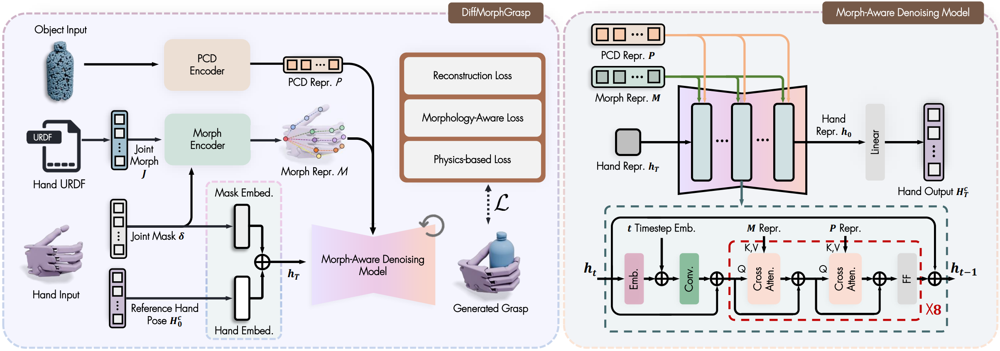

# DiffMorphGrasp [CoRL 2026]

The official repository of **DiffMorphGrasp: A Diffusion Framework Conditioned on Hand Morphology for Cross-Embodiment Grasp Generation**

<!-- 
[Zhiyuan Wu](https://georgewuzy.github.io/)<sup>1</sup>,
[Xiangyu Zhang](https://orcid.org/0009-0000-8690-514X)<sup>1</sup>,
[Zhuo Chen](https://zhuochenn.github.io/)<sup>1</sup>,
[Jiankang Deng](https://jiankangdeng.github.io/)<sup>2</sup>,
[Rolandos Alexandros Potamias](https://rolpotamias.github.io/)<sup>2</sup>,
[Shan Luo](https://shanluo.github.io/)<sup>1</sup>

<sup>1</sup> King's College London · <sup>2</sup> Imperial College London -->


<p align="center">
    <a href='https://arxiv.org/abs/2602.00915'>
      
    </a>
    <a href='https://arxiv.org/pdf/2602.00915'>
      
    </a>
    <a href='https://georgewuzy.github.io/DiffMorphGrasp-website/'>
      
    </a>
</p>



This release supports the three seen hands **Barrett, Allegro, and ShadowHand** (training and inference) and two unseen hands **Leap Hand and Inspire Hand** (inference).

## Dependencies

Create a new conda environment. My CUDA version (nvcc --version) is 12.4
```bash  
conda create -n diffmorphgrasp python=3.8 pip
conda activate diffmorphgrasp
pip install torch==2.4.0 torchvision==0.19.0 --index-url https://download.pytorch.org/whl/cu124
git clone https://github.com/facebookresearch/pytorch3d.git
cd pytorch3d
python setup.py install
cd ../
``` 

Install required packages.
```bash  
pip install -r requirements.txt
python -m pip install --no-build-isolation --no-deps 'git+https://github.com/Silverster98/pointops.git@86c68b1e63092152b4ab14ff09b832c5d2d0dc97'
``` 

Install Isaac Gym Environment (for validation).

Download [Isaac Gym](https://developer.nvidia.com/isaac-gym/download) from the official website, then:
```bash  
tar -xvf IsaacGym_Preview_4_Package.tar
cd isaacgym/python
pip install -e .
cd ../../
``` 

## Data and checkpoint

Download the processed dataset from [OneDrive link](https://emckclac-my.sharepoint.com/:u:/g/personal/k24021603_kcl_ac_uk/IQDViMqWhPuET6V92Ujv1GsMASTW27e2b6qjGgO65kVU0aE?e=3b2wns) and the pretrained checkpoint from [OneDrive link](https://emckclac-my.sharepoint.com/:u:/g/personal/k24021603_kcl_ac_uk/IQA-QTOGWy5rQbUDSfLSQ8iiAYmxRHZUellwT3Ctq5sEgcs?e=flJVVZ). Place them as follows:

```text
checkpoints/pretrained.pth
data/MultiDex_filtered/
  object_pcds_nors.pkl
  allegro/allegro_new.pt
  barrett/barrett_new.pt
  shadowhand/shadowhand_new.pt
  object/<dataset>/<object>/<object>.stl
  object/<dataset>/<object>/<object>.urdf
```

The default paths are configured in `configs/default.yaml`.

## Grasp Generation Inference

```bash
python sample.py
```

To select one hand or checkpoint:
```bash
python sample.py 'robot_name=[barrett]' checkpoint=checkpoints/pretrained.pth
python sample.py 'robot_name=[leaphand]'
python sample.py 'robot_name=[inspire]'
```

For a single-object run, add `'objects=[contactdb+apple]'`.

Set `penetration_optimization=true` to optimize hand-object penetration.

## Evaluate

```bash
export LD_LIBRARY_PATH="$CONDA_PREFIX/lib:$PWD/isaacgym/python/isaacgym/_bindings/linux-x86_64:${LD_LIBRARY_PATH:-}"
bash scripts/evaluate_all.sh outputs/samples/YOUR_TIMESTAMP
```

To evaluate one hand:
```bash
python scripts/evaluate.py --input outputs/samples/YOUR_TIMESTAMP/barrett --robot barrett
```

## Visualize

```bash
python scripts/visualize_grasp.py --input outputs/samples/YOUR_TIMESTAMP --robot shadowhand --object apple --index 0
```

## Training

```bash
python train.py exp_dir=outputs/train_baseline
```

## Citation

If you find this work helpful, please consider citing us using the following BibTeX entry:

```bibtex  
@article{wu2026unimorphgrasp,
  title={UniMorphGrasp: Diffusion Model with Morphology-Awareness for Cross-Embodiment Dexterous Grasp Generation},
  author={Wu, Zhiyuan and Zhang, Xiangyu and Chen, Zhuo and Deng, Jiankang and Potamias, Rolandos Alexandros and Luo, Shan},
  journal={arXiv preprint arXiv:2602.00915},
  year={2026}
}
```

## Contact

If you have any questions, feel free to contact me through email at [zhiyuan.1.wu@kcl.ac.uk](mailto:zhiyuan.1.wu@kcl.ac.uk).
